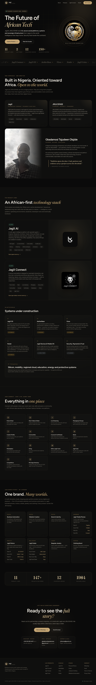
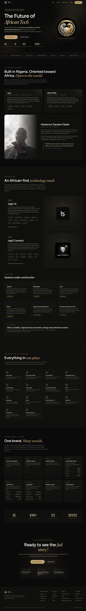

# JagX & JRILICENSE — Product Showcase

A fully animated, single-page marketing site presenting **JagX** and **JRILICENSE** as companies and covering their complete product portfolio — from the JagX AI agent and the JagX Connect social platform through to the systems, silicon, mobility and cloud bets on the horizon.

Built as a static site: no build step, no dependencies, no framework. Open `index.html` and it runs.

**Live preview:** https://static.teamily.ai/sites/8896cb5a-29d8-40ba-8690-d07164ac8836/webpages/jagx-showcase_v2/index.html

---

## Preview

| Desktop | Mobile |
|---|---|
|  |  |

---

## What's on the page

| Section | Contents |
|---|---|
| **Hero** | Animated crest ring, floating orbs, parallax, primary CTAs |
| **Brand marquee** | Seamless scrolling strip of the product family |
| **About** | JagX and JRILICENSE as companies, plus the founder story |
| **Products** | JagX AI and JagX Connect as full features; six in-build cards; the long horizon |
| **JagX Connect deep dive** | 14 capability cards — posts, Reels, live streaming, messaging, communities, courses, books, marketplace, hiring, gifts, JagX Coins |
| **JagX World Studio** | Eight worlds with their real product lineups |
| **Stats band** | Animated counters |
| **Contact / footer** | WhatsApp, email and product links |

### Products covered

**Live** — JagX AI (agent platform), JagX Connect (social platform)

**In build** — JagX OS, AetherBase, Vireo, Noder, JagX Name, JagX Mail

**Long horizon** — devices, silicon, mobility, cloud, payments

**JagX World Studio** — phones (Pulse X1, Aurum Fold), motors (Velox GT, Pulse EV), estate, jewelry, clothing

---

## Tech

- **HTML5** — one self-contained `index.html` (~1,000 lines)
- **CSS3** — custom design system, no framework. CSS custom properties, `clamp()` fluid type, grid and flexbox
- **Vanilla JavaScript** — `IntersectionObserver` scroll reveals, animated counters, cursor-tracking card glow, hero parallax, mobile menu
- **Fonts** — Figtree and Fraunces via Google Fonts
- **Zero dependencies** — no npm, no bundler, no build step

### Design system

| Token | Value | Use |
|---|---|---|
| `--ink` | `#0a0a0a` | Primary background (brand near-black) |
| `--gold` | `#c4a574` | Primary accent (brand gold) |
| `--gold-bright` | `#e8d3a8` | Highlight accent |
| `--paper` | `#f4efe6` | Body text |
| `--live` | `#6fbf9a` | "Live" status |
| `--build` | `#d9a441` | "In build" status |

### Animation

Scroll-triggered reveals with staggered delays, animated stat counters, a seamless brand marquee, cursor-tracking glow on product cards, hover micro-interactions, hero parallax, and a full mobile menu. Every animation is wrapped in a `prefers-reduced-motion` guard, so the site is fully usable with motion disabled.

---

## Running locally

No install required. Pick whichever you have:

```bash
# Option 1 — Python (usually already installed)
python3 -m http.server 8000

# Option 2 — Node
npx serve .

# Option 3 — PHP
php -S localhost:8000
```

Then open <http://localhost:8000>.

> Opening `index.html` directly via `file://` also works, but a local server is recommended so relative asset paths and fonts resolve exactly as they do in production.

---

## Deploying

The site is plain static files, so any static host works. Three are pre-configured in this repo.

### GitHub Pages (configured)

A workflow is included at `.github/workflows/deploy-pages.yml`. To enable it:

1. Push this repo to GitHub.
2. Go to **Settings → Pages**.
3. Under **Build and deployment → Source**, select **GitHub Actions**.
4. Push to `main` — the workflow deploys automatically.

The site goes live at `https://<username>.github.io/<repo-name>/`.

### Netlify

`netlify.toml` is included. Either drag the folder onto <https://app.netlify.com/drop>, or connect the repo — the publish directory is already set to `.`.

### Vercel

`vercel.json` is included. Run:

```bash
npx vercel --prod
```

Or import the repo at <https://vercel.com/new> — it is detected as a static site with no build command.

### Any other host

Upload the repository contents to your web root. There is nothing to compile. The only requirement is that `index.html` sits at the root of the served directory.

---

## Project structure

```
.
├── index.html              # The entire site — markup, CSS and JS
├── images/
│   ├── jagx-crest.jpg      # JagX crest logo
│   ├── jagx-connect.png    # JagX Connect app icon
│   ├── jagx-ai-logo.svg    # JagX AI mark
│   ├── jagx-jri-logo.png   # JRILICENSE logo
│   ├── founder.jpg         # Founder portrait
│   └── favicon.png         # Favicon
├── screenshots/            # README preview images
├── .github/workflows/
│   └── deploy-pages.yml    # GitHub Pages deployment
├── netlify.toml            # Netlify config
├── vercel.json             # Vercel config
├── .nojekyll               # Tells GitHub Pages to serve files as-is
├── .gitignore
├── LICENSE
└── README.md
```

---

## Editing

Everything lives in `index.html`. The CSS is in a single `<style>` block at the top; the JavaScript is in a single `<script>` block at the bottom. Section anchors are `#about`, `#products`, `#connect`, `#studio` and `#contact`.

To change brand colours, edit the custom properties in `:root` — the whole page follows.

---

## Notes

- The site is a **static showcase**. The "Get in touch" links point to the real WhatsApp number and email addresses rather than a form, so there is no backend to maintain.
- Product lineups under **JagX World Studio** are presented as product lines. If any are concept rather than shipping, adjust the status labels in the Studio section.
- Brand assets are the property of JagX and JRILICENSE. See `LICENSE`.

---

## License

MIT for the code. Brand assets — logos, crest, product names and the founder portrait — remain the property of JagX and JRILICENSE. See [LICENSE](LICENSE).

---

Built by JagX & JRILICENSE.
